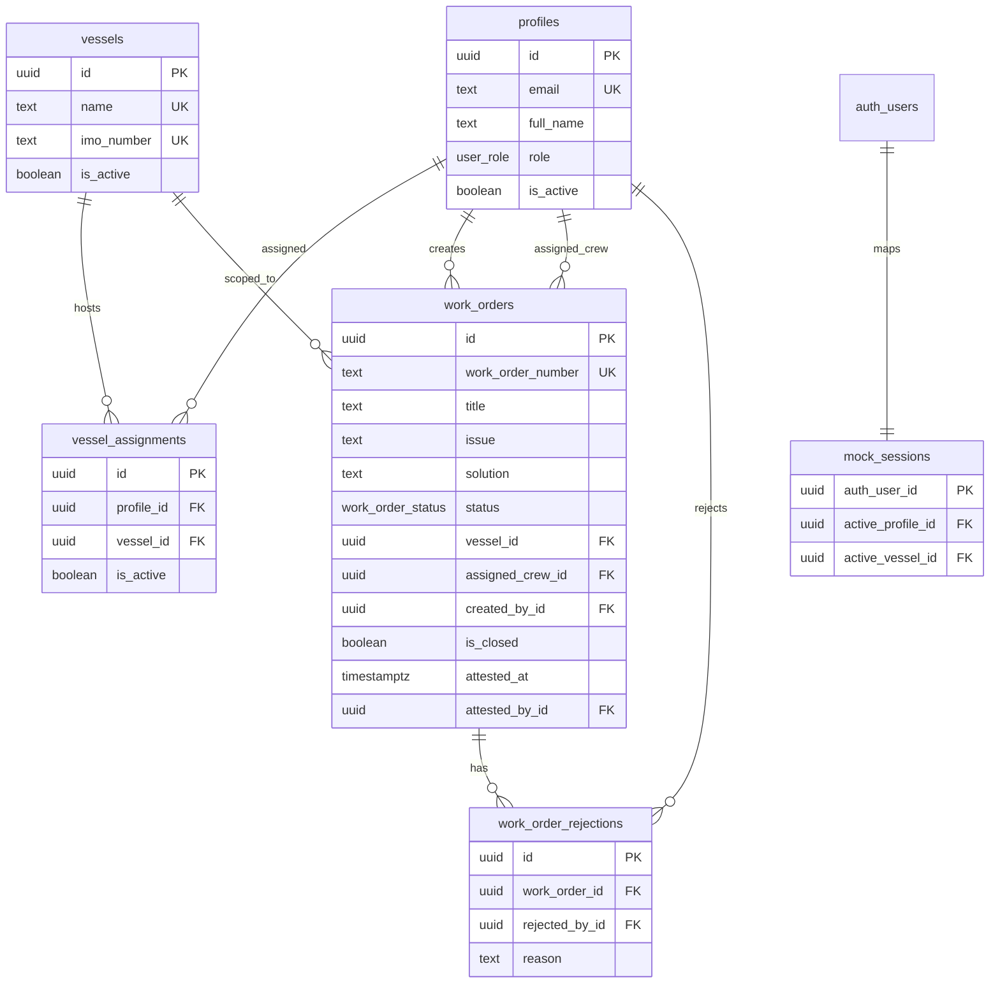

# Marine Work Order Management

Mini-dashboard for vessel-scoped work orders, crew management, and multi-role operations. Built with **Next.js (App Router)**, **TypeScript**, **Supabase** (browser client + RLS/RPC authorization), and **shadcn/ui**.

## Live URLs

After you complete [Deployment](#deployment), paste your links here:

| Resource | URL |
| --- | --- |
| Production app | `https://your-app.vercel.app` |
| GitHub repository | `https://github.com/alvinlaroya/Marine-Work-Order-Management.git` |

## Features

- **Mock reviewer auth bar** — dependent **Vessel → Role → Member** switcher; switching member updates permissions via `mock_sessions` + Supabase RLS.
- **Anonymous Supabase Auth** — one browser session; impersonation is intentional for reviewers (not production user auth).
- **Work order lifecycle** — Open → In Progress → Done → Captain attest/reject with rejection history.
- **Admin** — users, roles, vessels, assignments with database-side validation and deactivation guards.
- **UI / UX** — sidebar navigation on desktop and a bottom tab bar on mobile, a numbered 1-2-3 switcher in a sticky top bar, light/dark theme, role-aware overview with attention lists, status tabs with counts and search on work orders, a progress stepper and history timeline on each order, confirmation dialogs for destructive admin actions, toast feedback, and loading/empty/error states. Built with shadcn/ui and TanStack Query caching/invalidation.

## Entity relationship diagram



Full SQL (tables, indexes, RLS, RPCs): [`schema.sql`](schema.sql) (same as [`supabase/schema.sql`](supabase/schema.sql)). Demo data: [`supabase/seed.sql`](supabase/seed.sql).

## Security model

- **RLS** on all business tables; reads scoped by impersonated profile role and vessel assignments.
- **Mutations** go through **security definer RPCs** (`create_work_order`, `admin_*`, `captain_*`, `crew_*`, `switch_mock_session`).
- **Reviewer mode limitation**: anyone with the anon key can impersonate users via the switcher — acceptable for assessment; not a replacement for real authentication.

## Local setup

1. **Supabase project**
   - Enable **Anonymous sign-ins** (Authentication → Providers).
   - Run [`supabase/schema.sql`](supabase/schema.sql) then [`supabase/seed.sql`](supabase/seed.sql) in the SQL editor.

2. **Environment**

   ```bash
   cp .env.example .env.local
   ```

   Set `NEXT_PUBLIC_SUPABASE_URL` and `NEXT_PUBLIC_SUPABASE_ANON_KEY`.

3. **Install & run**

   ```bash
   npm install
   npm run dev
   ```

   Open [http://localhost:3000](http://localhost:3000).

4. **Quality**

   ```bash
   npm run lint
   npm test
   npm run build
   ```

## Demo personas (seed)

| Email | Role | Vessel |
| --- | --- | --- |
| admin@fleet.local | Admin | All (selector) |
| captain.star@fleet.local | Captain | MV Ocean Star |
| crew.star1@fleet.local | Crew | MV Ocean Star |
| captain.dawn@fleet.local | Captain | MV Harbor Dawn |
| crew.dawn1@fleet.local | Crew | MV Harbor Dawn |

## Deployment

1. **Supabase (production)**  
   - Enable **Anonymous sign-ins**.  
   - Run [`schema.sql`](schema.sql) then [`supabase/seed.sql`](supabase/seed.sql).

2. **Environment** — in Vercel (and locally in `.env.local`):

   ```env
   NEXT_PUBLIC_SUPABASE_URL=...
   NEXT_PUBLIC_SUPABASE_ANON_KEY=...
   ```

3. **GitHub (public repo)**

   ```bash
   git init -b main
   git add -A
   git commit -m "Marine work order dashboard"
   gh auth login
   gh repo create marine-work-order-management --public --source=. --push
   ```

4. **Vercel**

   ```bash
   npx vercel --prod
   ```

   Link the GitHub repo in the Vercel dashboard for continuous deployment.

5. Update the **Live URLs** table at the top of this README.

### Windows npm TLS note

If `npm install` fails with `UNABLE_TO_VERIFY_LEAF_SIGNATURE`, use:

```bash
npm install --strict-ssl=false
```

## Assumptions and key decisions

### Assumptions

- The app is an assessment/demo environment, so seeded personas and reviewer impersonation are intentional. A production version would use individual sign-in.
- Each user has one role (Admin, Captain, or Crew), while vessel access is controlled through assignments.
- A work order belongs to one vessel and one crew member. Captain attestation closes the order; rejection returns it to the crew with a reason.

### Decisions

- **Database-enforced security:** Supabase RLS and RPCs are the source of truth for permissions. Hiding UI actions alone is not treated as authorization.
- **Simple architecture:** The Next.js client talks directly to Supabase, avoiding a separate API layer that this project does not require.
- **Traceable workflow:** Rejections and crew activity are stored as history rather than overwriting previous actions.
- **Reviewer-friendly UX:** Role switching, seeded data, responsive navigation, clear status states, and feedback messages make each workflow quick to test.
- **Focused scope:** The implementation prioritizes the required work-order and admin flows over production concerns such as file attachments, notifications, and full authentication.

## Tech stack

- Next.js 16 App Router, TypeScript, Tailwind CSS v4
- shadcn/ui (Radix primitives)
- Supabase JS client (browser), PostgreSQL RLS + RPCs
- TanStack Query, Zod, Vitest
